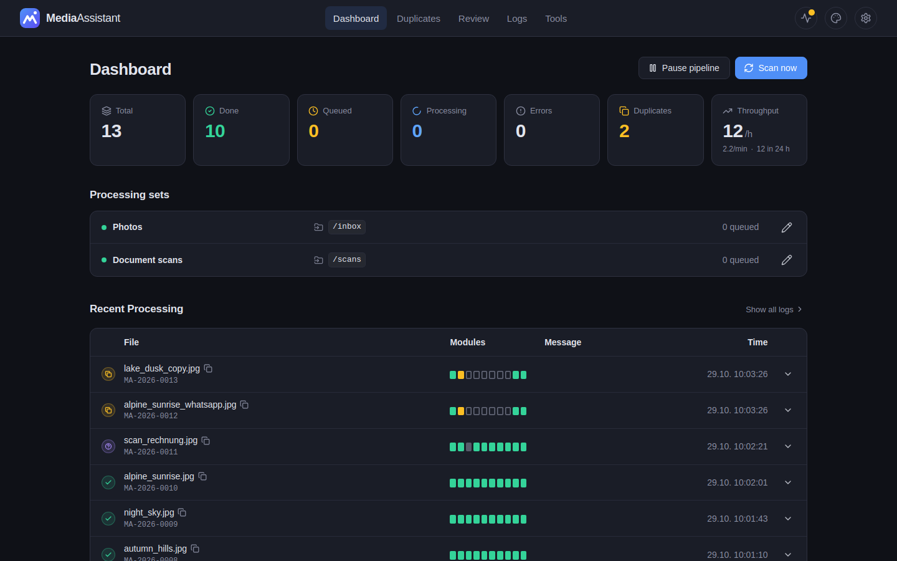
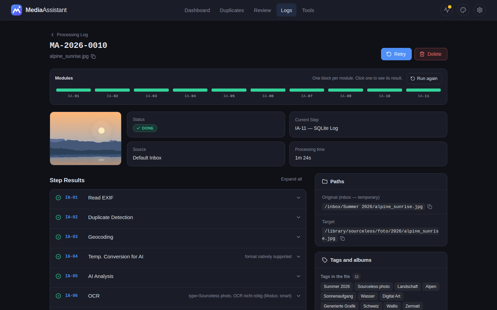
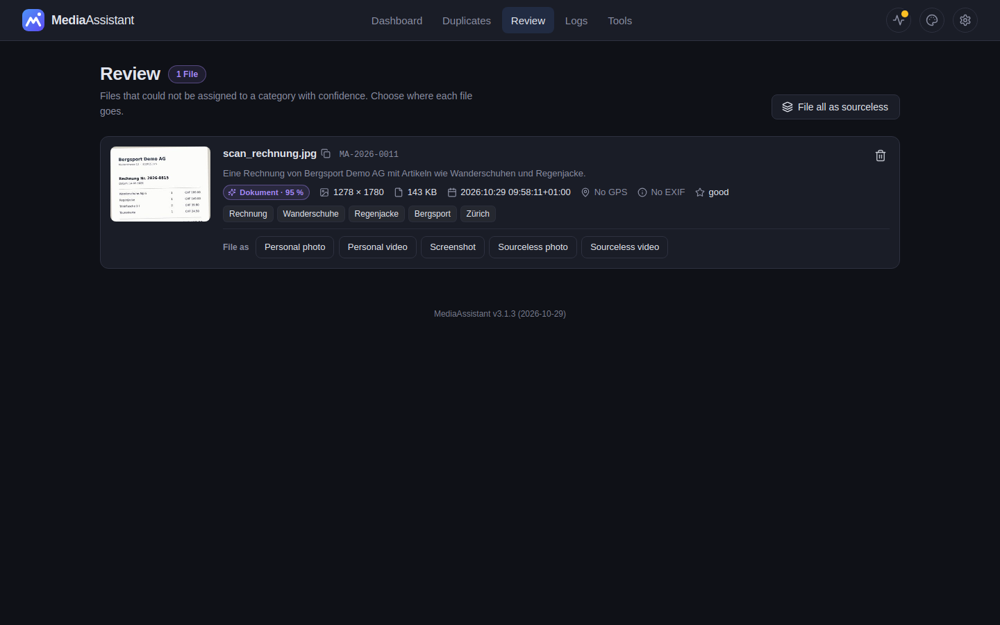
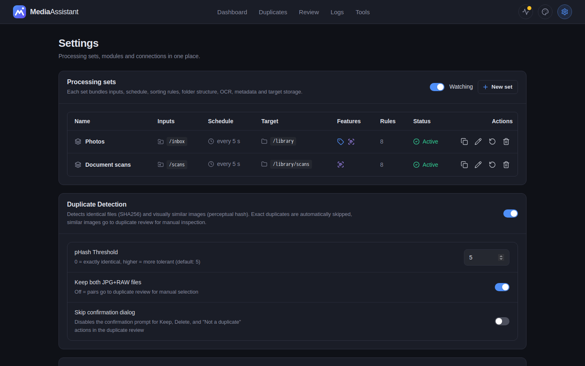
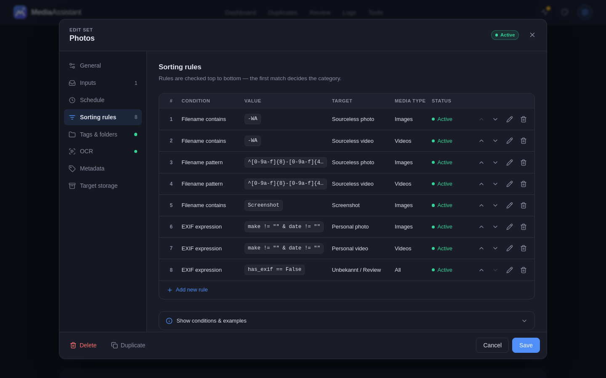
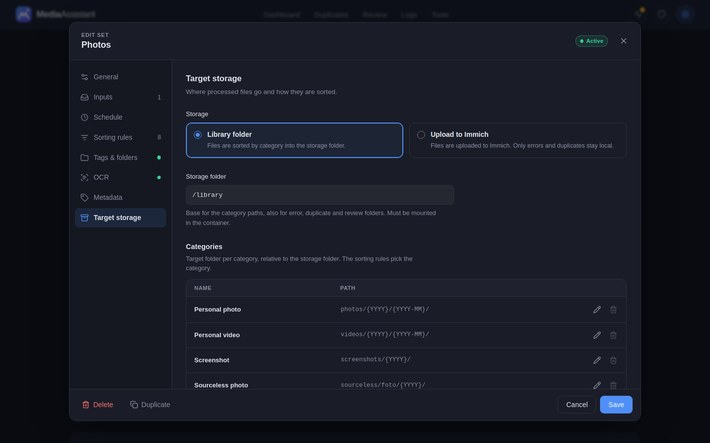
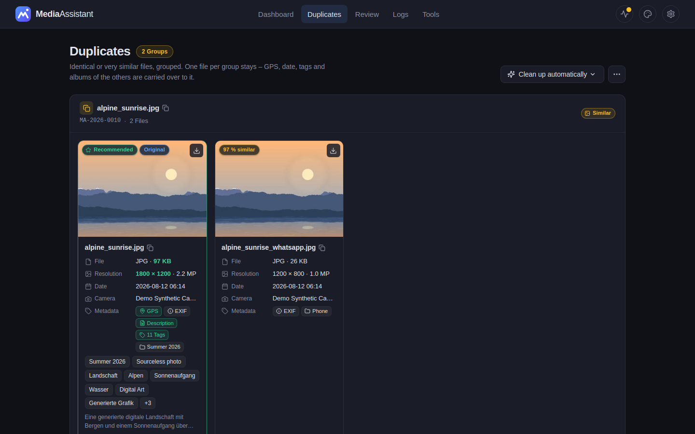
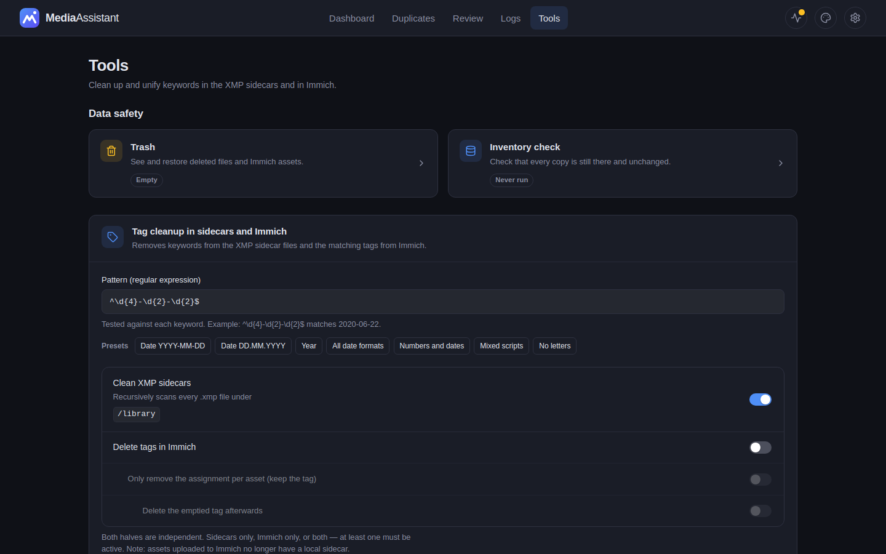

<picture>
  <source media="(prefers-color-scheme: dark)" srcset="logos/mediaassistant_logo_dark.svg">
  
</picture>

Drop your photos and videos into a folder. MediaAssistant takes care of the rest: metadata extraction, AI-powered tagging, duplicate detection, geocoding, and automatic sorting into your library or Immich.



<sub>All screenshots come from a demo instance with synthetic pictures.</sub>

## What it does

- **Processing sets** — Any number of independent setups, each with its own inputs, schedule, rules, folder tags, OCR, metadata mode and target storage
- **Automatic processing** — New files are detected and run through an 11-step pipeline
- **AI-powered tagging** — Every photo and video gets descriptive keywords, a category, and a description
- **Duplicate detection** — SHA256 (exact) and perceptual hash (similar) matching across images and videos
- **Geocoding** — GPS coordinates are resolved to place names and written as EXIF keywords
- **Immich integration** — Upload to Immich with albums from folder structure, or auto-tag mobile uploads
- **OCR** — Text recognition for screenshots and documents
- **Sorting** — Configurable rules and AI-verified classification sort files into the right folders
- **Tag tools** — Bulk-remove junk keywords and merge spelling variants across sidecars and Immich
- **Diagnostics API** — Read-only JSON view of modules, settings, jobs, and logs behind its own tokens

## Pipeline

```
Inbox  →  EXIF  →  Duplicates  →  Geocoding  →  Convert  →  AI  →  OCR  →  Tags  →  Sort  →  Notify  →  Library
```

| Step | Name | What it does |
|------|------|-------------|
| IA-01 | Read EXIF | Extract metadata via ExifTool; videos via ffprobe (GPS, date, duration, resolution, codec) |
| IA-02 | Duplicates | SHA256 + pHash matching. Duplicates go to a review folder. Videos use averaged frame hashes |
| IA-03 | Geocoding | GPS coordinates to place names (country, city, suburb) via Nominatim, Photon, or Google |
| IA-04 | Convert | HEIC/DNG/RAW/GIF to temp JPEG for AI; video frame extraction via ffmpeg |
| IA-05 | AI Analysis | Vision AI classifies type, source, tags, description. Categories from database |
| IA-06 | OCR | Text recognition for screenshots and documents |
| IA-07 | Write Tags | AI tags, geocoding, folder tags, description written to EXIF (direct or sidecar mode) |
| IA-08 | Sort | Static rules + AI verification. Move to library or upload to Immich with albums |
| IA-09 | Notify | Email on errors (SMTP) |
| IA-10 | Cleanup | Remove temporary files |
| IA-11 | Log | Processing summary to database |

## Highlights

### Job Detail — Every Module at a Glance


One block per module, green when it did its job. Open a step to see its result, rerun single modules, and follow every file operation in the timeline.

### Review — Manual Classification


Files the AI is uncertain about land in the review queue. Classify them manually with one click.

### Settings — Processing Sets


Any number of sets, each with its own inputs, schedule, sorting rules, folder tags, OCR mode, metadata mode and target storage.

### Settings — Sorting Rules


Flexible rules based on filename, regex, EXIF expressions, or file extension. First match wins. AI verifies all files.

### Settings — Target Storage


Library folder or Immich upload. Configurable structure with placeholders ({YYYY}, {COUNTRY}, {CAMERA}, ...), one path per category.

### Duplicate Review — Side-by-Side Comparison


Compare duplicates with thumbnails, metadata, and quality scores at a glance. Keep the best file, clean up groups automatically, or mark false positives. Removed files go to the trash, never straight to deletion.

### Tools — Trash, Inventory Check, Tag Cleanup


Restore files from the trash, check that every copy is still there and unchanged, and remove or merge keywords across sidecars and Immich.

### Authentication — SSO Login
Secure access via OIDC/OAuth2. Works with Authentik, Keycloak, Authelia, or any compatible provider — one click to sign in.

## Quick Start

```bash
mkdir mediaassistant && cd mediaassistant
curl -O https://raw.githubusercontent.com/marcohediger/mediaassistant/master/docker-compose.yml
curl -O https://raw.githubusercontent.com/marcohediger/mediaassistant/master/.env.example
cp .env.example .env
```

Edit `.env`:

```env
# AI Backend (LM Studio, Ollama, etc.)
AI_BACKEND_URL=http://<ai-host>:1234/v1
AI_MODEL=qwen/qwen3-vl-4b

# Paths
INBOX_PATH=/volume1/inbox
LIBRARY_PATH=/volume1/library

# Timezone
TZ=Europe/Zurich
```

Start:

```bash
docker compose up -d
```

Web interface: **http://localhost:8000**

The image is published to `ghcr.io/marcohediger/mediaassistant` (`:latest`
and one tag per version). Every release is also mirrored, digest-identical,
to a self-hosted Gitea registry; if you run your own, the workflow's
`mirror-to-gitea` job does the same for you once `GITEA_REGISTRY`,
`GITEA_REGISTRY_USER` and `GITEA_REGISTRY_TOKEN` are set on the repository.

On first start, a setup wizard guides you through the configuration.

## Processing Sets

Everything that decides *how* a file is processed belongs to a **processing
set** — and you can have as many as you like. Each set bundles:

| Area | Per set |
|---|---|
| Inputs | Any number of inbox directories and/or Immich auto-tagging with its own access |
| Schedule | Continuous, time window, scheduled or manual, with its own interval |
| Sorting rules | Its own rule list |
| Folder tags | On or off |
| OCR | On or off, and the mode (screenshots/documents only, or every image) |
| Metadata | Write directly into the file or into an XMP sidecar; read Google Takeout JSON |
| Target storage | Library folder or upload to Immich, its own base path and categories |

AI backends, geocoding, duplicate detection, video thumbnails, the Immich
server and its accesses, SMTP and diagnostics stay global. Duplicates are
detected across all sets. A directory belongs to exactly one set.

In **Settings → Processing sets** each set is one row with the essentials;
the pencil opens it in a popup with one tab per area. Saving validates the
whole set first and then writes it in one transaction — a rule pointing to a
category the set does not have, an invalid pattern, or a directory already
owned by another set is rejected and nothing changes.

**Upgrading changes nothing.** On the first start after the update the
existing configuration becomes a set called "Standard" that behaves exactly
as before; directories with different switches are split into separate sets,
and every named Immich user that was polled gets a set of its own.

### How files move through the system

```
 Set A ─┬─ directories ──┐
        └─ Immich poll ──┤                     ┌────────────────┐
 Set B ─── directories ──┼──► enqueue only ──► │ jobs (queued)  │ ──► one worker ──► pipeline
 CSV retry ──────────────┤                     └────────────────┘     (slots, pause,
 Retry / duplicate UI ───┘                                             hang detection)
```

Inputs only put jobs into the queue; the worker is the only place that runs
the pipeline, so slot limits, pause and hang detection apply to every job.
Immich originals are downloaded when the worker starts the job — a restart in
between simply downloads again.

## Immich Integration

MediaAssistant works bidirectionally with Immich:

**Inbox to Immich** — Toggle per inbox directory. Files are analyzed, tagged, and uploaded with albums created from folder structure. The original is deleted from the inbox after upload.

**Immich to Pipeline** — Enable polling to auto-process new mobile uploads. Tags, descriptions, and geocoding are added. Assets uploaded by MediaAssistant are automatically skipped (no double processing).

**Archiving** — Categories like screenshots or sourceless images are automatically archived in Immich (hidden from timeline). NSFW content is moved to the locked folder.

## Duplicate Review

Duplicates are detected automatically and placed in a review queue:

- Side-by-side comparison with thumbnails, EXIF data, keywords, and quality scores
- **Keep this** — triggers full pipeline re-run with merged metadata from all group members
- **Batch-Clean** — automatically keeps the best quality file per group with live progress bar
- **Not a duplicate** — re-processes the file through the full pipeline
- GPS, date, keywords, description, and folder tags are merged automatically

## Tag Tools

The **Tools** tab cleans up keywords that have accumulated over time — in the
XMP sidecars, in Immich, or in both. Nothing is ever changed without a preview
first, and every run can be cancelled while it is going.

### Removing keywords by pattern

Search by regular expression and see exactly what matches before deleting:

| Preset | Pattern | Finds |
|---|---|---|
| Dates | `^\d{4}-\d{2}-\d{2}$` | `2024-08-17` |
| Years | `^\d{4}$` | `2024` |
| Numeric | `^(\d+\|\d{4}-\d{2}-\d{2}\|\d{2}\.\d{2}\.\d{4})$` | `7.1`, `2024`, `17.08.2024` |
| No letters | `^[\W\d_]+$` | `?????`, `---` |
| Mixed scripts | see preset | `Sunset夕日` |

Two switches decide where the removal happens, plus a sub-switch for Immich:

- **Sidecars** — the keyword is stripped from the XMP files in your library
- **Immich** — the tag is deleted server-side
- **Per asset** (sub-switch) — removes the assignment from every asset
  individually instead of deleting the tag, optionally deleting the emptied
  tag afterwards

### Merging spelling variants

Finds tags that mean the same thing but were written differently, and merges
them onto one spelling:

```
Strand | strand | STRAND        →  Strand
Zürich | Zurich | Zuerich       →  Zürich
Europapark | Europa Park        →  Europa Park
Fußspuren | Fussspuren          →  Fußspuren
```

The spelling with the most photos wins; on a tie, the longer one — that is the
one that still has its umlauts and spacing. The others are moved onto it and
only then deleted, so no photo loses a tag.

Only names that are character-for-character the same word are merged. There is
no fuzzy matching: `Haus` and `Maus` stay apart, and so do `Hund` and `Hunde`.

**Broken umlauts are repaired.** A tag like `?berschwemmungen` is
`Überschwemmungen` whose Ü a broken encoding destroyed. Which letter it was
cannot be read off the string, so every plausible one is tried and only a
spelling that actually exists can match:

```
?berschwemmungen  →  Überschwemmungen
K?se              →  Käse
```

A damaged spelling never wins, even with more photos. Where it fits several
words — `M?ller` fits both `Müller` and `Moller` — size decides, not the
alphabet. With no partner at all, the tag is left alone rather than guessed.

> **Run both halves.** Merging in Immich alone does not hold: the old spelling
> stays in the XMP sidecar and Immich re-creates it as a new tag on the next
> re-index. Both switches are on by default for that reason.

## Diagnostics API

A read-only JSON endpoint for looking into a running instance without shell
access. Tokens are generated in **Settings**, several can exist side by side,
and each one can be switched off without deleting it.

```bash
curl -H "Authorization: Bearer $TOKEN" https://your-host/api/diagnostics
curl -H "Authorization: Bearer $TOKEN" "https://your-host/api/diagnostics?logs=200&level=ERROR"
curl -H "Authorization: Bearer $TOKEN" "https://your-host/api/diagnostics?job=MA-2026-12345"
```

The path is `/api/diagnostics`. Only that prefix is exempt from the login
middleware — `/diagnostics` is redirected to the login page and never
reaches the token check.

The report covers the version, pipeline state, every module's health, the
settings, job counts, the Immich and AI connectivity probes, the inbox
directories, and the most recent log entries.

Nothing can be changed through it, and no secret is ever returned — an API key
or password shows up only as `set`, `unset`, or `undecryptable`. Without a
valid token the endpoint answers `404`, so it does not advertise its own
existence.

## Folder Tags

When a processing set has folder tags switched on, the subdirectory names below its inbox become EXIF keywords and Immich albums:

```
/inbox/vacation/italy/photo.jpg
  → Keywords: vacation, italy
  → Immich Album: vacation italy
```

## Sorting Rules

Every processing set has its own rules, evaluated before AI classification:

| Condition | Example |
|-----------|---------|
| Filename contains | `-WA` (WhatsApp) |
| Filename pattern | `^IMG_\d+` (regex) |
| EXIF expression | `make != "" & date != ""` |
| File extension | `.png` |

Each rule maps to a category of its set (or skips the file) and has a media type filter (All / Images / Videos). First match wins.

## Library Structure

Each processing set has its own base path and categories; target paths use placeholders:

```
/library/
├── photos/{YYYY}/{YYYY-MM}/          ← personal photos
├── videos/{YYYY}/{YYYY-MM}/          ← personal videos
├── sourceless/foto/{YYYY}/           ← memes, forwarded images
├── screenshots/{YYYY}/               ← screenshots
└── error/duplicates/                 ← detected duplicates
```

## Supported Formats

**Images:** JPG, JPEG, PNG, HEIC, HEIF, TIFF, WebP, GIF, BMP, DNG, CR2, NEF, ARW

**Videos:** MP4, MOV, AVI, MKV, M4V, 3GP

## Architecture

- **Backend:** Python 3.12, FastAPI, SQLAlchemy (async), aiosqlite
- **Database:** SQLite with WAL mode
- **Container:** Docker with ExifTool, FFmpeg, libheif (GIF and HEIC fallback via Pillow/pillow-heif)
- **AI:** Any OpenAI-compatible Vision API (LM Studio, Ollama, etc.)
- **Geocoding:** Nominatim, Photon, or Google Maps
- **i18n:** German and English
- **Theme:** Dark and Light mode

## Authentication (SSO)

OIDC/OAuth2 authentication via Authentik, Keycloak, Authelia, or any OIDC-compliant provider.

```yaml
environment:
  - AUTH_MODE=oidc
  - OIDC_ISSUER=https://auth.example.com/application/o/mediaassistant/
  - OIDC_CLIENT_ID=mediaassistant
  - OIDC_CLIENT_SECRET=your-secret-here
```

Set `AUTH_MODE=disabled` (default) for no authentication.

## Environment Variables

Settings are imported into the database on first start. After that, use the web interface.

Variables that describe processing — `FILEWATCHER_INTERVAL`,
`FILEWATCHER_SCHEDULE_MODE`, `OCR_MODE`, `METADATA_WRITE_MODE`,
`METADATA_GOOGLE_JSON`, `LIBRARY_BASE_PATH` — only take effect on the very
first start, when they flow into the "Standard" processing set. Change them
per set in the settings afterwards; `LIBRARY_BASE_PATH` additionally serves
as the default base path for new sets.

| Variable | Description |
|----------|-------------|
| `AI_BACKEND_URL` | AI backend URL |
| `AI_MODEL` | AI model name |
| `AI_API_KEY` | AI backend API key (if required) |
| `IMMICH_URL` | Immich server URL |
| `IMMICH_API_KEY` | Immich API key |
| `GEOCODING_PROVIDER` | nominatim / photon / google |
| `SMTP_SERVER` / `SMTP_PORT` / `SMTP_USER` / `SMTP_PASSWORD` | Email notifications |
| `LIBRARY_BASE_PATH` | Library base path |
| `INBOX_PATH` | Default inbox path |
| `UI_LANGUAGE` | de / en |
| `UI_THEME` | dark / light |

## Safe File Operations

Every file move uses copy → verify hash → delete. No data loss even on interrupted operations.

## Encrypted Configuration

API keys and passwords are encrypted with Fernet (AES-128-CBC) in the database.

## Companion Tools

| Tool | Purpose |
|------|---------|
| [ma-sidecar-repair](https://github.com/marcohediger/ma-sidecar-repair) | Repair broken XMP sidecars |
| [ma-ghost-tag-detect](https://github.com/marcohediger/ma-ghost-tag-detect) | Find hallucinated AI tags |

## License

Private project by Marco Hediger.
